# Workflow d'un ticket frontend — de la maquette au ship

Le déroulé complet d'un ticket frontend (ex. KOM-07), en six étapes : implémentation de la
maquette, planification des tests, écriture des tests avant le code, écriture du code,
review, puis ouverture de la PR et merge.

Ce workflow est l'adaptation frontend de `docs/workflow-ticket-backend.md` du repo
`kommit-backend`. Le critère de tri des tests est identique ; ce qui change, c'est
la nature des dépendances, la forme des smokes et l'ajout de l'étape 0.

## Vue d'ensemble

```mermaid
flowchart TD
    START(["Ticket Notion en DOING<br/>règles métier (RM)"])

    subgraph S0 ["0 · Intégrer la maquette"]
        MOCK["/write-ui<br/>2 subagents : code-fetcher + flow-describer<br/>V1 (code brut) → V2 (code propre)"]
        MOCKOUT[/"composants sous src/<br/>maquettes/&lt;série&gt;/ (bruts, assets, FLOW.md)"/]
        MOCK --> MOCKOUT
    end

    subgraph S1 ["1 · Planifier les tests"]
        INV["test-planner (agent)<br/>classe chaque RM :<br/>🟢 unitaire · 🟠 mixte · 🔴 manuel"]
        INVOUT[/"testing/inventaire-&lt;ID&gt;.md"/]
        INV --> INVOUT
    end

    subgraph S2 ["2 · Écrire les tests — test-first, AVANT le code"]
        WT["/write-tests<br/>lit l'inventaire, décide qui a du travail,<br/>lance les writers EN PARALLÈLE (1 fois chacun)"]
        TFU["unit-test-writer<br/>tests Vitest ROUGES<br/>RM 🟢 + part unitaire des 🟠"]
        TFS["smoke-test-writer<br/>scénarios navigateur en langage humain<br/>RM 🔴 + complément des 🟠"]
        TFUOUT[/"src/**/*.test.ts (rouges)"/]
        TFSOUT[/"testing/smokes-&lt;ID&gt;.md"/]
        WT --> TFU --> TFUOUT
        WT --> TFS --> TFSOUT
    end

    subgraph S3 ["3 · Écrire le code — jusqu'au vert, puis e2e"]
        IMPL["/write-code<br/>src/logic/ (pur) → composants → câblage"]
        VERIF{"Suite verte ?<br/>vitest + typecheck + lint"}
        ALL{"Tout le ticket au vert ?"}
        E2E["e2e-test-writer<br/>Playwright, tous les smokes transcrits<br/>écrit APRÈS le code vert · lancé à la demande · hors CI"]
        IMPL --> VERIF
        VERIF -- non, corriger --> IMPL
        VERIF -- oui --> ALL
        ALL -- non, tranche suivante --> IMPL
        ALL -- oui --> E2E
    end

    subgraph S4 ["4 · Review du code"]
        REV["/review-code → code-reviewer<br/>constats classés ⛔ / ⚠️ / 💡<br/>(ne modifie aucun fichier)"]
        BLOCK{"Constat bloquant ⛔ ?"}
        REV --> BLOCK
    end

    subgraph S5 ["5 · Ouvrir la PR, puis merger"]
        GATE{"Verrou qualité<br/>lint + typecheck + test"}
        OPR["/open-pr<br/>push + PR vers dev, corps dérivé des commits"]
        HUMAN(["Validation humaine<br/>review + QA sur la PR"])
        MPR["/merge-pr<br/>merge de la PR vers dev<br/>invoqué à la main, PR par PR"]
        GATE -- rouge --> IMPL
        GATE -- vert --> OPR --> HUMAN --> MPR
    end

    START --> MOCK
    MOCKOUT --> INV
    INVOUT --> WT
    TFUOUT --> IMPL
    TFSOUT --> IMPL
    E2E --> REV
    BLOCK -- oui, corriger --> IMPL
    BLOCK -- non --> GATE
```

Entre chaque étape, un **point de contrôle humain** (`h` sur le schéma de référence) :
l'utilisateur valide la sortie avant de lancer l'étape suivante.

## Ordonner un ticket à plusieurs pages

Un ticket porte souvent plusieurs pages / flux (KOM-07 : signup, signin, signout). L'unité de
travail reste **le ticket, pas le flux** — et le workflow se parcourt **horizontalement** :

- l'**étape 1 est ticket-wide** : `test-planner` classe les RM des trois flux d'un coup, une
  seule fois ;
- on finit l'**étape 0 pour tous les flux** (toutes les pages existent en statique) avant de
  passer aux tests ;
- les **étapes 2 et 3 se déroulent une fois sur tout le ticket**, puis **une** review et
  **un** merge.

Pourquoi pas flux par flux (vertical) : les pages d'une même US partagent leur domaine et
leur logique (validation, mapping d'erreur, état du bouton, toast — signin ≈ signup moins un
champ). Découper par flux ferait écrire une fonction `src/logic/` « pour un flux » puis y
revenir pour le suivant — le même travers que « ne pas découper par paquet » à l'étape 3, un
cran plus haut. Le vertical ne se justifie que si les pages sont des **features
indépendantes**, ce qui n'est pas le cas d'un flux d'authentification.

---

# Stratégie de test

Elle vit dans son propre doc : `docs/testing-strategy.md` (les 3 niveaux de test, la question de tri, la frontière côté front, ce qu'on n'utilise pas, Playwright, le format des smokes).

---

# Les étapes en détail

## 0. Intégrer la maquette

Étape absente du workflow backend. Le skill `/write-ui` prend le lien de chaque frame Figma, dans l'ordre du parcours, et
délègue à deux subagents cloisonnés : `mockup-code-fetcher` (code brut + assets sur
disque) et `mockup-flow-describer` (résumé textuel du flux). L'orchestrateur implémente
ensuite **depuis les fichiers bruts**, jamais depuis un screenshot.

Sortie : les composants sous `src/` (V2, code propre) et le matériau de référence sous
`maquettes/<série>/` à la racine. Aucune logique métier n'est câblée à cette étape : les
états (erreur, bouton désactivé) sont **exprimables via props**, pas pilotés.

Règles applicables : `figma-design-to-code`, `files`, `ui`, `icones`, `perimetre-frontend`.

## 1. Planifier les tests

L'agent `test-planner` prend le lien du ticket, lit **le contenu de la page Notion** (les RM sont
dans le corps, pas dans les propriétés) et classe chaque RM en 🟢 / 🟠 / 🔴 avec, pour
chacune, ce qui doit être testé et pourquoi ce verdict.

Il lit aussi la section **« Contraintes techniques »** du ticket : une contrainte pousse
souvent une RM vers 🔴 ou 🟠.

Sortie : `testing/inventaire-<TICKET_ID>.md`. C'est lui qui fixe le périmètre de l'étape 2.

**Sans règles métier dans le ticket, on s'arrête et on ne devine rien.**

## 2. Écrire les tests (avant toute implémentation)

Le skill `/write-tests` lit l'inventaire, décide quels writers ont du travail et les lance
**en parallèle, une seule fois chacun** — il n'écrit aucun test lui-même. Deux agents, deux
livrables distincts, tous deux produits **avant** le code :

- **Tests unitaires rouges** (`unit-test-writer`) — les RM 🟢 et la part unitaire des 🟠,
  en Vitest sur `src/logic/`. Rouges par construction : l'implémentation n'existe pas. La
  trace test ↔ RM vit dans les noms des `describe`/`it` (chaque bloc nomme sa RM), pas dans
  un fichier séparé.
- **Scénarios de smoke** (`smoke-test-writer`) — les RM 🔴 et le complément des 🟠, dans
  `testing/smokes-<TICKET_ID>.md`, au format de `docs/testing-strategy.md`.

Les deux fichiers jouent le même rôle : fixer le cahier des charges (comportements,
messages, navigations) avant d'écrire le code.

## 3. Écrire le code

`/write-code` fait passer au vert les tests rouges du ticket. Le cahier des charges est les
tests rouges s'ils existent, sinon les smokes + le ticket — rien de plus. On n'impose aucun
découpage par paquet : l'unité de travail se lit dans les tests (ouvrir un fichier de test,
écrire la fonction **en entier**, passer au suivant).

L'implémentation suit les couches du repo : **`src/logic/` (fonctions pures, aucun import
React) → composants → câblage**. La rule `tests.md` impose la question préalable : « puis-je
sortir cette logique dans une fonction sans rendu ? » Si oui, on l'extrait.

**Vérification**, au fil de l'eau :

- tests concernés verts (`pnpm test:run`) ;
- `pnpm build` (typecheck via `tsc -b`) ;
- lint sans erreur.

**En fin d'étape, l'agent `e2e-test-writer` transcrit tous les smokes du ticket en tests
Playwright** (un e2e par scénario de smoke), **après** que le code est vert — jamais avant.
Ils sont lancés à la demande, hors CI. Aucune part ne reste en smoke manuel : le smoke est
la source, l'e2e sa version exécutable (voir `docs/testing-strategy.md`, « Playwright : transcription de tous les
smokes, après le code, hors CI »).

## 4. Review du code

Le skill `/review-code` prépare le contexte (périmètre, ticket, vérifications déjà passées), lance l'agent `code-reviewer` une seule fois, et restitue sa revue telle quelle. L'agent relit le diff complet de la branche. Il **ne modifie aucun fichier** :
il rend une revue classée par gravité — ⛔ bloquant, ⚠️ à corriger, 💡 suggestion — avec
l'emplacement `chemin:ligne`, le mécanisme concret et une correction proposée. Un constat
⛔ renvoie à l'étape 3 ; sinon on passe à l'ouverture de la PR.

## 5. Ouvrir la PR, puis merger

Deux skills distincts, tous deux **invoqués à la main** — la séparation est ce qui garde la
porte entre « proposer » et « intégrer ».

**`/open-pr`** amène le travail jusqu'à la PR, sans merger :

1. **Verrou qualité** bloquant : lint, typecheck, tests. Au premier rouge, rien n'est poussé.
2. `git push` de la branche feature.
3. **PR ouverte vers `dev`** (pas `main`), corps dérivé des commits.

Puis la **validation humaine** sur la PR : review et QA de bout en bout. Tant qu'elle n'est
pas faite, on ne merge pas.

**`/merge-pr`** merge la PR vers `dev`, **seulement quand tu l'invoques**. Le merge reste une
décision humaine explicite, donnée pour cette PR précise (rule Git du repo) : ce skill ne
s'enchaîne jamais tout seul après `open-pr` ni après la review.

---

# Ce que chaque étape produit

| Étape | Artefact |
|---|---|
| 0 · Intégrer la maquette | composants sous `src/` + `maquettes/<série>/` (bruts, assets, `FLOW.md`) |
| 1 · Planifier | `testing/inventaire-<ID>.md` |
| 2 · Écrire les tests | `src/**/*.test.ts` (rouges) + `testing/smokes-<ID>.md` |
| 3 · Écrire le code | code sous `src/`, suite verte, e2e Playwright de tous les smokes (`e2e/`) |
| 4 · Review | revue classée ⛔ / ⚠️ / 💡 (aucun fichier modifié) |
| 5 · PR + merge | PR ouverte vers `dev`, puis merge sur `dev` (invoqué à la main) |

---

# État de l'outillage dans ce repo

| Étape | Outillage | État |
|---|---|---|
| 0 · Intégrer la maquette | skill `write-ui` + agents `mockup-code-fetcher`, `mockup-flow-describer` | ✅ complet |
| 1 · Planifier | agent `test-planner` | ✅ créé |
| 2 · Écrire les tests | skill `write-tests` + agents `unit-test-writer`, `smoke-test-writer` | ✅ créés |
| 3 · Écrire le code | skill `write-code` + agent `e2e-test-writer` (Playwright, tous les smokes, hors CI) | ✅ créés |
| 4 · Review | skill `review-code` + agent `code-reviewer` | ✅ créés (compare face à `dev`) |
| 5 · PR + merge | skills `open-pr` puis `merge-pr` | ✅ créés (PR + merge vers `dev`, ticket en `TO TEST`) |
